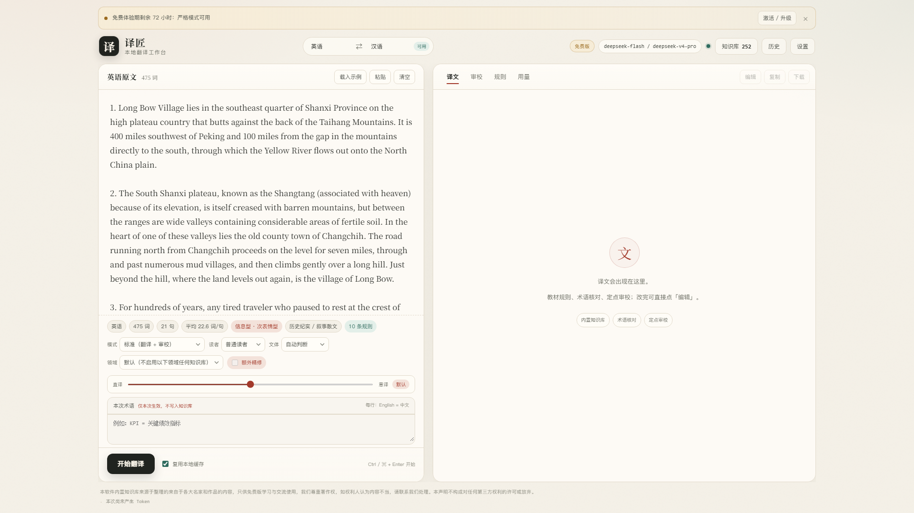

# 译匠 · Yijiang

**开源、免费的 Windows 本地英汉翻译软件：把翻译规矩做成可导入、可编辑的知识库。**

翻译内容不经过译匠服务器。用户自带 API Key；原文只从本机发往用户自己选择的模型接口。

**下载页：<https://yijiang-git.github.io/yijiang/>**　|　[源码目录](src/)　|　[反馈](https://github.com/Yijiang-git/yijiang/issues)

## 这是什么

译匠不是在线翻译网站，而是一款装在本机的 Windows 软件。它把翻译判断拆成规则、案例和术语，翻译时按原文特征检索，在本机组装提示词，再经过翻译、审校和定点修复完成交付。

- **软件本体开源、免费**，全部功能可用；
- 不需要注册、激活码、订阅或许可服务器；
- 模型调用使用你自己的 API Key，模型费用由模型服务商收取；
- 169 / 260 知识库是**可选内容包**，不买也能用，也可以导入自己的规则、案例和术语。

## 版本与价格

| 版本 | 价格 | 功能 | 知识库 |
|---|---|---|---|
| 免费开源版 | ¥0 | 全部功能 | 随包 1 条身份卡；可自建 / 导入 |
| 169 知识库（可选） | ¥9.9 买断 | 全部功能 | 169 规则 / 24 案例 / 100 术语 |
| 260 知识库（可选） | ¥19.9 买断 | 全部功能 | 260 规则 / 24 案例 / 190 术语 |

**功能不分档。** 买不买知识库，快速 / 标准 / 严格模式、精修、审校、导入导出、知识库编辑都完全一致。知识库不是解锁条件。

知识库买断，无年费、无到期限制、无激活码、无设备绑定。169 / 260 只交付 JSON 文件，不单独提供安装包。

## 下载

- 官网：<https://yijiang-git.github.io/yijiang/>
- Windows 安装包：`docs/downloads/译匠-免费版-0.2-Setup.exe`
- Windows 免安装 zip：`docs/downloads/译匠-免费版-0.2.zip`

当前只提供 Windows 10 / 11 x64；Android / macOS / iOS 不支持。

## 功能统计

| 项目 | 数量 / 说明 |
|---|---|
| 翻译模式 | 3 种：快速 / 标准 / 严格 |
| 读者类型 | 4 种：普通 / 专业 / 学生 / 儿童 |
| 领域 | 默认 + 11 个领域 |
| 每次检索规则 | 5 条 |
| 每次参考案例 | 1 个 |
| 每次匹配术语 | 最多 20 条 |
| 审校检查 | 默认 10 项 |
| 长文分块 | 默认约 900 词 / 块 |
| 完整知识库 | 260 规则 / 24 案例 / 190 术语 / 40 core |
| 正则硬条件卡 | 17 张 |
| 知识库备份 | 最近 30 份 |
| 单元测试 | 46 个 |

## 主要功能

- **三种模式**：快速只翻译；标准翻译 + 审校；严格分析 + 审校 + 定点修复。
- **读者与领域**：普通 / 专业 / 学生 / 儿童；政经、法律、广告、商务、科技医学、新闻传媒、影视字幕、旅游、学术、儿童文学、诗歌。
- **直译—意译滑杆**：按目标语自然度调整策略。
- **规则检索**：BM25 + 触发特征 + 优先级 + 冲突组 + 正则硬条件；事实、数字、专名优先于风格。
- **术语与案例**：术语锁定译名；案例提供处理路径；都支持自建和导入。
- **审校与修复**：高/中/低问题清单、自动定点替换、严格模式再修一轮。
- **保真红线**：情态、否定、数量、专名、物主、转述动词、事件名词、句间关系不得丢失。
- **本地数据**：历史在 SQLite；API Key、知识库、备份用 Windows DPAPI 加密。
- **知识库管理**：查看、搜索、新建、编辑、删除、导入、导出、备份、恢复出厂。
- **批量能力**：命令行长文批处理支持并发、断点续跑、翻译记忆、章节摘要、分级审校。

更完整的统计与用法见 `RELEASE_NOTES.md` 与源码目录中的 `src/README.md`。

## 快速开始

1. 下载并安装免费开源版。
2. 打开「设置」，填 OpenAI 兼容接口地址、API Key、模型名。
3. 点「测试连接」。
4. 粘贴英文原文，选择模式 / 读者 / 领域。
5. 点「开始翻译」，在「审校」页查看问题，编辑后复制或下载 TXT。
6. 需要知识库时，在「知识库 → 导入」选择 `kb-template.json`；不导入也能用全部功能。

## 技术栈

- Python 3 / FastAPI / Uvicorn / SQLite
- WebView2 桌面窗口
- PyInstaller onedir + Inno Setup
- OpenAI 兼容 `/chat/completions` 接口
- 源码目录：[`src/`](src/)

> 源码采用 MIT 许可；169 / 260 知识库数据不随源码分发，另有单独授权，见 [LICENSE-KNOWLEDGE-BASE.md](LICENSE-KNOWLEDGE-BASE.md)。

## 常见问题

**必须用 DeepSeek 吗？**  
不必。任何 OpenAI 兼容 `/chat/completions` 接口都可以，模型名可直接填。

**会上传我的文章吗？**  
不会上传到译匠服务器（没有）。原文会发给你自己配置的模型服务商。

**免费版和知识库差在哪？**  
功能没有差别。软件本体免费，知识库只是可选数据包；不买也能用，也可以自己导入。

**SmartScreen 提示“未知发布者”？**  
安装包未做代码签名。点「更多信息 → 仍要运行」。

**支持 Android / macOS 吗？**  
当前只提供 Windows 10 / 11 x64。

## 许可

- **软件代码**：MIT，见 [LICENSE](LICENSE)。
- **169 / 260 知识库数据、内置规则/案例/术语**：不适用 MIT，见 [LICENSE-KNOWLEDGE-BASE.md](LICENSE-KNOWLEDGE-BASE.md)。

## 反馈

微信搜索【译匠公众号】，或在 GitHub Issues 留言。请附系统版本、复现步骤和报错信息。
