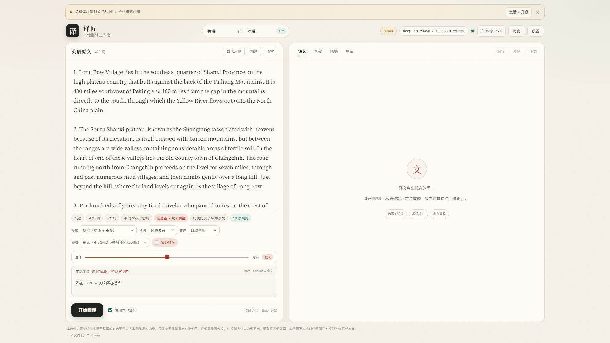
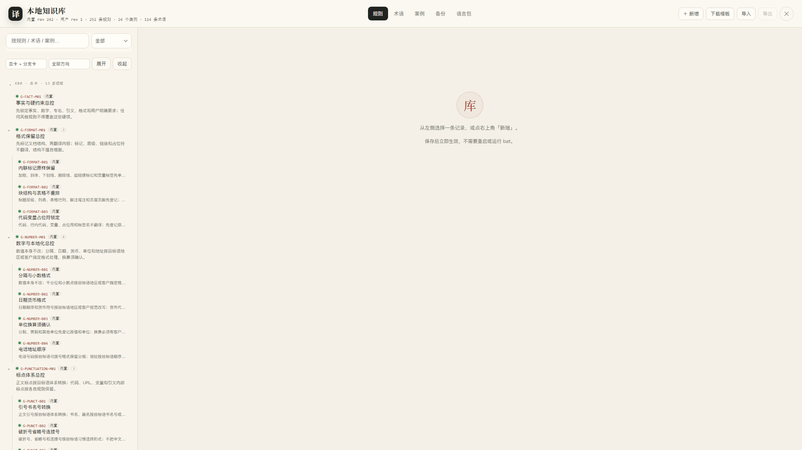
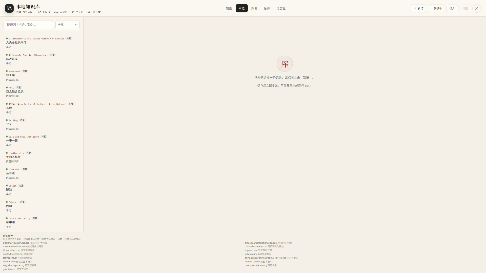

# 译匠 · Yijiang

**一个装在本机的英汉翻译工作台：把你的翻译规矩，变成一套可检索、可执行的知识库。**

翻译内容不经过译匠服务器。用户自带 API Key；原文只从本机发往用户自己选择的模型接口。轻量版/完整版的授权校验会连接 Cloudflare Pages 许可服务器，只传订单号与随机安装 ID。

**下载页：<https://yijiang-git.github.io/yijiang/>**　|　[ Releases ](https://github.com/Yijiang-git/yijiang/releases)

## 三个版本

| 版本 | 价格 | 严格模式 | 知识库额度 | 获取方式 |
|---|---|---|---|---|
| 免费版 | ¥0 | 前 72 小时不限次，之后每天 3 次 | 规则 3 / 案例 1 / 术语仅临时 | 直接下载 |
| 轻量版 | ¥49/年 | 每天 50 次 | 规则 50 / 案例 10 / 术语 20 | 面包多购买后发货 |
| 完整版 | ¥89/年 | 不限次 | 不限量 | 面包多购买后发货 |
| 企业版 | 不公开销售 | 不限次 | 不限量 | 仅按需联系公众号 |

企业版不经过除 API 端以外的任何服务器，适合对链路有严格要求的用户；公开版需要联网激活/续期。

免费版下载（Windows / Android）：

- <https://github.com/Yijiang-git/yijiang/releases/download/v0.2/yijiang-free-setup.exe>
- <https://github.com/Yijiang-git/yijiang/releases/download/v0.2/yijiang-free.apk>

轻量版与完整版不在公开仓库托管，购买入口：微信搜索【译匠公众号】，或到 <https://yijiang-git.github.io/yijiang/> 的购买区。
退款与售后规则见 <https://yijiang-git.github.io/yijiang/refund.html>。

校验和：<https://github.com/Yijiang-git/yijiang/releases/download/v0.2/SHA256SUMS.txt>

## 它是什么

市面上的翻译工具大多在比“模型谁更强”。译匠比的是另一件事：
**你希望这类文本怎么译。**

- 259 条规则卡，覆盖 15 个领域：政经、法律、商务、科技医学、新闻、旅游、学术、儿童文学、诗歌……
- 每条规则带触发条件、方向、阶段、冲突组；翻译时按原文特征检索 10 条进提示词。
- 24 个整段案例、114 条术语；术语用 Aho–Corasick 匹配，5 万条实测约 4 ms/段。
- 快速 / 标准 / 严格三种模式；标准与严格带片段审校与定点修复。
- 历史、术语、案例、知识库全部在本机；内置库加密随包分发。

## 功能

| | 桌面端 | 手机端 |
|---|---|---|
| 系统 | Windows 10/11 x64（WebView2） | Android 7.0+ |
| 翻译模式 | 快速 / 标准 / 严格 | 快速 / 标准 / 严格 |
| 知识库 | 259 规则 / 24 案例 / 114 术语；案例、术语可查看，规则库仅企业版可查看 | 案例 / 术语 / 我的规则 |
| 术语 | 全局 + 本次临时术语 | 本机术语库 |
| 审校 | 片段级，问题清单 + 定点修复 | 同左 |
| 数据 | SQLite + 本地加密文件 | SharedPreferences + 私有目录 |
| API | 任意 OpenAI 兼容 `/chat/completions` | 9 家供应商 + 自定义 |

  
  

## 免费测试版说明

- 快速 / 标准翻译：永久免费
- 严格模式：首次启动后 72 小时内不限次，之后每天 3 次
- 案例与术语可查看；内置规则库仅未公开的企业版可查看（公开版只显示你自己新建的规则）
- 可新增 3 条规则、1 个案例；术语导入、额外精修、片段审校为付费能力
- 知识库导出仅企业版提供
- 72 小时到期只锁严格模式，不影响其他功能

内置知识库与译文由作者整理 / 生成；引用的公开双语材料权利归原作者。

## 快速开始

1. 安装并启动。
2. 设置 → 选服务商 → 填接口地址与 API Key → 保存。
3. 粘贴原文 → 开始翻译。

Windows 10 需要 [WebView2 Runtime](https://developer.microsoft.com/microsoft-edge/webview2/)；Win11 自带。

## 常见问题

**SmartScreen 提示“未知发布者”？**
测试版未做代码签名。点「更多信息 → 仍要运行」。

**必须用 DeepSeek 吗？**
不必。任何 OpenAI 兼容接口都可以，模型名可直接填。

**会上传我的文章吗？**
不会上传到译匠的服务器（没有）。但原文会发给你配置的模型服务商。

**翻译到一半失败？**
看 `startup.log`；长文建议分段，每段 500–1500 字最稳。

更多见 [PRIVACY.md](PRIVACY.md)、[CHANGELOG.md](CHANGELOG.md)。

## 许可

免费测试版，个人使用免费；禁止转售、破解、单独提取内置知识库。
详见 [LICENSE](LICENSE)。

## 反馈

微信搜索【译匠公众号】。Issue 也欢迎，请附系统版本、复现步骤、日志。

